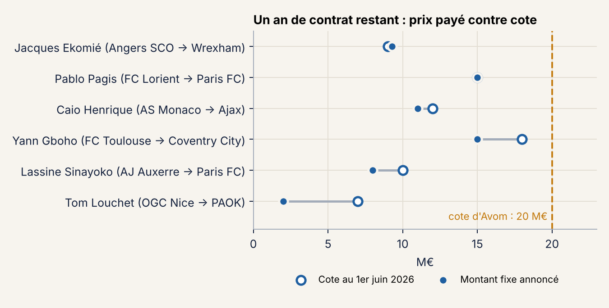
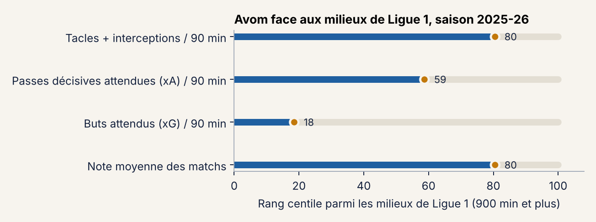

# Arthur Avom : le dossier qu'un agent préparerait avant janvier

Arthur Avom, milieu de Lorient, a 21 ans, une cote de 20 M€ et un contrat qui se termine le 30 juin 2027. Lorient n'a pas réussi à le vendre cet été. Dans deux mois, le mercato d'hiver ouvre, et un club étranger pourra lui faire signer un pré-contrat. Je me suis mise à la place de son agent : combien il vaut, à quel prix des joueurs dans la même situation sont partis, et quelle option défendre.

Le résultat tient en deux pages : [la note de négociation](notes/note_agent_FR.pdf), avec [une version anglaise d'une page](notes/agent_note_EN.pdf). Le notebook [dossier_avom.ipynb](dossier_avom.ipynb) montre d'où vient chaque chiffre.

*C'est un exercice sur données publiques : je ne représente ni le joueur ni le club, et je n'ai pas vu son contrat.*

## Ce que j'ai trouvé

**Le meilleur repère, ce n'est pas la cote, ce sont les ventes de l'été.** J'ai retrouvé dans la presse six joueurs de Ligue 1 vendus entre juin et septembre 2026 alors qu'il leur restait un an de contrat. Cinq sont partis entre 0,8 et 1,03 fois leur cote Transfermarkt. Le sixième, Tom Louchet, est parti de Nice pour 2 M€ avec une cote de 7 M€ : ça peut aussi très mal se passer.

**Mon modèle de prédiction donne une fourchette.** Entre 13 et 42 M€ pour sa cote de juin 2027. C'est large, et c'est honnête : à 21 ans, c'est là que le modèle se trompe le plus. Surtout, il ignore qu'il ne reste qu'un an de contrat, d'où l'importance des comparables.

**Sur le terrain, c'est un récupérateur.** Parmi les 92 milieux de Ligue 1 qui ont joué au moins 900 minutes en 2025-26, il est dans les 20 % qui font le plus de tacles et d'interceptions, mais il marque peu.

**Ce que je proposerais à l'agent :** ouvrir le marché dès janvier sans fermer la porte au départ libre, et ne prolonger que court avec une vraie hausse de salaire. La raison est juridique autant que financière : en France, on ne peut pas inscrire de clause libératoire dans un contrat homologué par la LFP, donc une prolongation ne garantit aucun prix de sortie au joueur.

## Le cadre juridique

Le notebook détaille chaque règle avec sa source : la rémunération de l'agent (Code du sport, art. L. 222-17), ce que change la loi du 3 août 2026 (carte professionnelle, déclaration des sommes, superviseurs payés sur une part de la commission), le pré-contrat à six mois de la fin (règlement FIFA, art. 18.3), le mécanisme de solidarité, le droit à l'image et le régime provisoire qui suit l'arrêt Diarra. J'ai un M2 en droit du sport et j'ai été juriste à la Ligue Hauts-de-France de handball : c'est la partie où je suis le plus à l'aise, et celle que les projets de data sur le football laissent souvent de côté.

## Ce que je ne sais pas

- Le contrat réel du joueur, son état physique, ce qu'il veut et les offres qu'il a reçues.
- Le prix d'une vente en janvier : je n'ai aucun comparable d'hiver, donc la fourchette de 10 à 16 M€ est une hypothèse, écrite comme telle.
- Les cotes s'arrêtent au 1er juin 2026, et une cote Transfermarkt reste une estimation faite par les contributeurs du site.
- Six transferts, c'est un ordre de grandeur. Avec plus de temps, je referais l'exercice sur plusieurs saisons.

## Les fichiers

| Fichier | Contenu |
|---|---|
| `dossier_avom.ipynb` | le raisonnement complet, exécuté |
| `notes/` | la note en français (2 pages), en anglais (1 page), en PDF et en HTML |
| `donnees/transferts_comparables_ete_2026.csv` | les six transferts, avec le lien vers chaque article |
| `donnees/predictions_2027_ligue1.csv` | les prédictions de mon [modèle de cote](https://github.com/jmeignen/prediction-valeur-joueurs) pour la Ligue 1 |
| `donnees/historique_cotes_cas_et_comparables.csv`, `joueurs_ligue1_transfermarkt.csv`, `apparitions_ligue1_2025_26.csv` | extraits du jeu de données [Football Data from Transfermarkt](https://www.kaggle.com/datasets/davidcariboo/player-scores) (CC0) |

Les statistiques détaillées 2025-26 (tacles, xG, xA) viennent d'un export FBref que je ne republie pas, pour respecter les conditions de Sports Reference. Sans ce fichier, la partie 2 du notebook ne se relance pas, mais ses résultats restent lisibles.

Pour le relancer : `pip install pandas numpy matplotlib`, puis Kernel → Restart & Run All.

Justine Meignen
